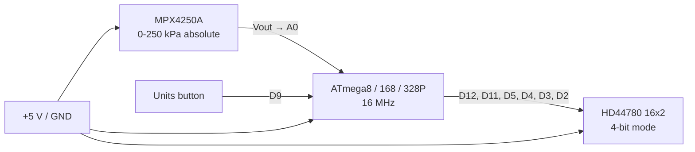

# Pinout

The pin map below is the one used by the original sketch and by the current
firmware. It is the authoritative map for the ATmega8/168/328P board.

## Microcontroller

| Function | Arduino pin | ATmega8/168/328P port pin | Notes |
|---|---|---|---|
| LCD RS | D12 | PB4 | also SPI MISO |
| LCD E | D11 | PB3 | also SPI MOSI |
| LCD D4 | D5 | PD5 | |
| LCD D5 | D4 | PD4 | |
| LCD D6 | D3 | PD3 | |
| LCD D7 | D2 | PD2 | |
| Sensor output | A0 | PC0 / ADC0 | MPX4250A Vout |
| Units button | D9 | PB1 | active high by default |
| Supply | — | VCC / AVCC | +5 V |
| Ground | — | GND | |

The LCD data nibble is deliberately crossed: LCD `D4` goes to Arduino `D5`,
and LCD `D5` goes to Arduino `D4`. That is what
`LiquidCrystal(12, 11, 5, 4, 3, 2)` expects, and it is how the original board
is wired. Do not "fix" it.

## LCD header (16 pins)

| LCD pin | Signal | Connect to |
|---|---|---|
| 1 | VSS | GND |
| 2 | VDD | +5 V |
| 3 | V0 | contrast wiper |
| 4 | RS | D12 |
| 5 | RW | GND |
| 6 | E | D11 |
| 7 | D0 | unused (4-bit mode) |
| 8 | D1 | unused |
| 9 | D2 | unused |
| 10 | D3 | unused |
| 11 | D4 | D5 |
| 12 | D5 | D4 |
| 13 | D6 | D3 |
| 14 | D7 | D2 |
| 15 | A | +5 V through the backlight resistor |
| 16 | K | GND |

`RW` must be tied low. The `LiquidCrystal` library never drives it, so a
floating RW line will make the display behave unpredictably.

## Units button

The original firmware used `pinMode(..., INPUT)` and treated a `HIGH` reading
as pressed. The default configuration preserves that wiring:

- Button between D9 and +5 V
- 10 kΩ pulldown from D9 to GND

If you wire a fresh button to ground instead, set
`BUTTON_ACTIVE_LOW = true` in `firmware/boostgauge/config.h`. The firmware will
then enable the internal pull-up and treat `LOW` as pressed.

## Sensor

The MPX4250A is an absolute pressure sensor, not a gauge sensor:

- `Vout` → A0
- `Vcc` → +5 V
- `GND` → GND

Check the package pinout in the NXP datasheet before soldering; the package
has more than three physical pins. Keep the sensor wiring short and add a
0.1 µF decoupling capacitor close to the sensor if you are rebuilding the
harness. The sensor port sees intake pressure after the turbo.

## Inter-board link

The two boards are joined with a Cat5 cable, but the link is not Ethernet. The
RJ45 pin assignment is in the Eagle schematic under `hardware/`. It is not
repeated here because the Eagle files are binary Eagle 5 format and could not
be netlisted without Eagle. Open the schematic before making a cable.

## Diagram

